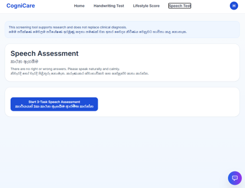
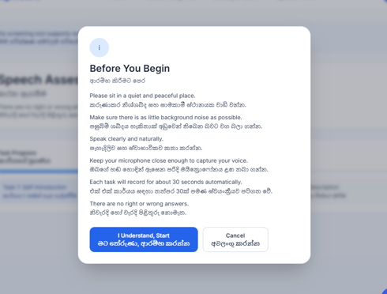
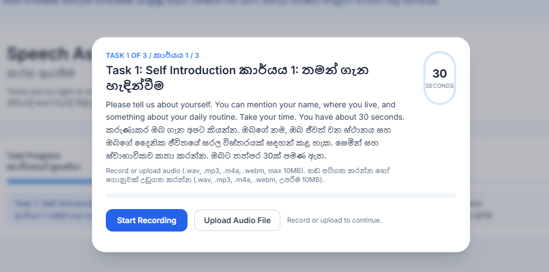
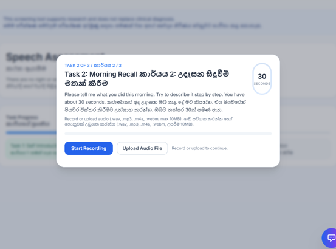
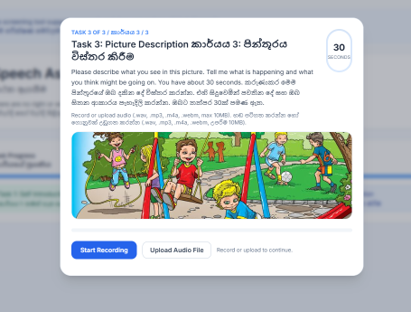
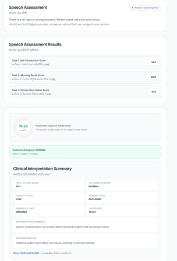
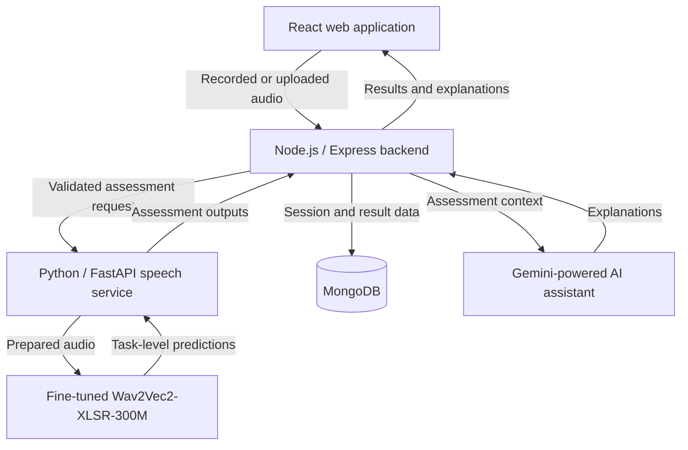

# CogniCare

## AI-Powered Cognitive Screening & Dementia Risk Analysis Platform

**Final-year research project · SLIIT · 2025–2026 · Project ID: 25-26J-439**

A collaborative research platform that brings together digital cognitive assessments and AI-assisted analysis for clinician review.

**Portfolio by [Hashmath Al-Hazan](https://github.com/HashmathAl-Hazan)**  
**My component:** Speech-Based Dementia Screening and AI Clinical Assistant.

[Original team repository](https://github.com/HimeshaSenaratne/research_proj_cognicare) · [Screenshots](#project-gallery) · [Research documents](#research-documents) · [My contribution](#my-contribution)

---

## About this repository

This repository presents my contribution to **CogniCare**, a final-year research project developed collaboratively at the **Sri Lanka Institute of Information Technology (SLIIT)**.

My work focused on the speech-assessment component, the AI clinical assistant, and integration across the frontend, application backend, machine-learning service, and database.

The [original collaborative repository](https://github.com/HimeshaSenaratne/research_proj_cognicare) contains the team's source implementation. This portfolio provides an overview of my work, application screenshots, and supporting research documents.

In the academic documents, my name appears as **Natheer H A H / Natheer Hashmath Al-hazan**, with student ID **IT22888952**.

## Project overview

The broader CogniCare platform brings together lifestyle and health profiling, cognitive and functional assessments, speech analysis, handwriting analysis, and MRI-based support within a clinician-oriented workflow.

My component explores recorded speech as an input for cognitive-risk screening. Participants complete three guided tasks:

| Task | Activity |
| --- | --- |
| Self Introduction | Describe themselves and their everyday routine. |
| Morning Recall | Recall and describe the events of their morning. |
| Picture Description | Describe what is happening in a displayed image. |

The application records or accepts uploaded audio, processes the responses, and presents task-level results and a final speech-assessment outcome. The AI clinical assistant provides explanations based on the available assessment context.

**Research scope:** CogniCare is a research prototype for cognitive-risk screening and clinician decision support. Its outputs do not establish a clinical diagnosis.

## My contribution

| Area | My work |
| --- | --- |
| Assessment experience | Developed the guided speech-assessment flow with English and Sinhala interface text, task instructions, and recording/upload controls. |
| Audio processing | Worked on audio validation, preprocessing, and integration with the speech-analysis service. |
| Speech-model integration | Integrated the fine-tuned **Wav2Vec2-XLSR-300M** model into the assessment workflow. |
| Backend integration | Connected the React interface, Node.js/Express gateway, Python/FastAPI ML service, and MongoDB persistence. |
| Result presentation | Contributed to task-level scores, final speech results, and clinician-facing interpretation displays. |
| AI clinical assistant | Contributed to the Gemini-powered explanation workflow using assessment context and model outputs. |
| Testing and deployment | Worked on assessment validation, service integration, testing, and deployment of the speech ML service. |

The [individual final thesis](docs/reports/IT22888952_FinalReport.pdf) documents my component. Section 3 of the [deployment report](docs/reports/25-26J-439_Deployment_Report.pdf) describes the speech-module deployment.

## Project gallery

These six screenshots follow the speech-assessment journey from the opening page to the results.

### 1. Speech assessment landing page

Entry point for the three-task assessment, with English and Sinhala interface text.

### 2. Before-you-begin instructions

Guidance on the recording environment, microphone placement, and task timing.

### 3. Self Introduction

The first task provides a spoken-response prompt and controls to record or upload audio.

### 4. Morning Recall

The second task asks the participant to describe their morning step by step.

### 5. Picture Description

The third task uses a visual scene to guide the spoken response.

### 6. Assessment results and interpretation

The results view displays individual task scores, a final speech score, an outcome category, and an interpretation summary.

The scores shown in the screenshot illustrate the application interface; they are separate from model evaluation metrics.

## Core capabilities

| Capability | Purpose |
| --- | --- |
| Three guided speech tasks | Collect structured responses across different speaking activities. |
| Bilingual interface | Present assessment guidance in English and Sinhala. |
| Browser recording and audio upload | Support microphone input and existing audio files. |
| Input validation | Check supported audio formats, file size, and required task inputs. |
| Speech-based inference | Process recorded speech using the fine-tuned Wav2Vec2-XLSR-300M model. |
| Transcription and supporting indicators | Provide acoustic and linguistic information for the assessment workflow. |
| Assessment results | Present task-level outputs, the final speech score, and an outcome category. |
| AI clinical assistant | Explain available results using the assessment context. |
| Session persistence | Store session and task-result data through the application backend. |

The screenshots and final thesis describe tasks of approximately **30 seconds** and support for **WAV, MP3, M4A, and WEBM** audio uploads, with a **10 MB** upload limit.

## Assessment workflow

1. Open the speech assessment and review the preparation instructions.
2. Complete Self Introduction, Morning Recall, and Picture Description.
3. Record or upload a response for each task.
4. Submit the recordings through the application backend for validation and processing.
5. Run speech-model inference through the ML service.
6. Store the task results and generate the final speech-assessment output.
7. Present the results and contextual explanations for review.

## Architecture

This diagram summarizes my speech-assessment component and its application integration.

## Technology stack

| Layer | Technologies documented in the project |
| --- | --- |
| Frontend | React.js, JavaScript, HTML, CSS |
| Application backend | Node.js, Express.js |
| ML inference service | Python, FastAPI |
| Speech model | Fine-tuned Wav2Vec2-XLSR-300M |
| Audio processing | FFmpeg |
| Transcription support | Google Speech-to-Text |
| AI clinical assistant | Gemini API |
| Database | MongoDB |
| Service integration | REST APIs |
| Testing | Jest, React Testing Library, Supertest, Pytest, Postman |
| Deployment work | AWS EC2 / Ubuntu in the deployment report; Docker-based workflows in the final thesis |
| Version control | Git, GitHub |

## Speech model and research data

The final speech-model implementation described in this portfolio uses **fine-tuned Wav2Vec2-XLSR-300M** for raw-audio classification.

The individual final thesis documents **Dem@Care DS3, DS5, and DS7** as the speech-data sources used for preparing the component's training and evaluation data. It also describes audio standardization, task-linked samples, and supporting acoustic and linguistic analysis.

The AI clinical assistant uses assessment context to explain the available results. See the [final thesis](docs/reports/IT22888952_FinalReport.pdf) for the methodology and evaluation discussion.

The attached research documents span different stages and experiments. The implementation overview here follows the individual final thesis and the illustrated speech workflow; the documents retain their original descriptions and results.

## Testing and deployment

The final thesis describes testing across the application and ML-service boundaries:

| Layer | Examples of documented checks |
| --- | --- |
| Frontend | Microphone-permission errors, recording start/stop, automatic stopping, supported uploads, oversized files, task progression, and error messages. |
| Backend | Session creation, task validation, missing audio, ML-service failure responses, and final-score generation. |
| ML service | Audio conversion, invalid input, processing timeouts, feature extraction, and prediction-response structure. |
| Transcription | Word error rate evaluation against reference transcripts. |

The deployment report documents the speech ML service on an Ubuntu-based AWS EC2 instance, including Python/FastAPI setup, FFmpeg installation, API testing, and integration checks.

Detailed evidence is available in the [final thesis](docs/reports/IT22888952_FinalReport.pdf) and [deployment report](docs/reports/25-26J-439_Deployment_Report.pdf).

## Research documents

### Final research and implementation

| Document | What it contains |
| --- | --- |
| [Individual final thesis — May 2026](docs/reports/IT22888952_FinalReport.pdf) | The speech-based screening and AI clinical assistant component: requirements, methodology, implementation, testing, and evaluation. |
| [Research paper](docs/reports/AI_Powered_Cognitive_Screening_and_Dementia_Risk.pdf) | The broader CogniCare platform, its multimodal workflow, team research, and reported experiments. |
| [Team deployment report — April 2026](docs/reports/25-26J-439_Deployment_Report.pdf) | Deployment documentation for the health/lifestyle, handwriting, speech, and MRI components. |

### Proposals and research background

| Document | What it contains |
| --- | --- |
| [Individual project proposal — June 2025](docs/reports/RP_Project_Proposal_IT22888952.pdf) | The original proposal for the speech, facial-expression, and task-behavior research scope. |
| [Initial team project proposal](docs/reports/Final_Year_Research_Project_Proposal.pdf) | The early CogniCare+ concept, proposed component scopes, objectives, and research plan. |
| [Research-gap references](docs/reports/researchGap-IT22888952.pdf) | Literature references and their mapping to research-gap comparison topics. |

The proposals document the original research direction. The final thesis describes the completed individual component.

Additional academic submission document

[Thesis similarity report](docs/reports/IT22888952.pdf) — the similarity-checking submission package, including the annotated thesis. This is separate from the clean final thesis linked above.

All seven PDFs are included in this repository. Each document title opens its corresponding file.

## Related research presentation

**Title:** AI-Powered Cognitive Screening & Dementia Risk Analysis Platform  
**Conference:** IEEE Region 10 Symposium — TENSYMP 2026  
**Presentation:** Presented virtually.  
**Paper:** [Read the supplied research manuscript](docs/reports/AI_Powered_Cognitive_Screening_and_Dementia_Risk.pdf).

**Paper authors:** Himesha Senaratne, Piruthivi Kulasegaram, Natheer Hashmath Al-hazan, Malindi Dissanayake, Manori Gamage, and Kaushalya Rajapakse.

## Credits

CogniCare was developed collaboratively by the final-year research team at SLIIT.

This portfolio describes **Hashmath Al-Hazan's contribution** to speech-based screening, the AI clinical assistant, and application integration. The original team repository remains the source for the collaborative implementation and contribution history.

The final thesis acknowledges **Ms. Manori Gamage** as supervisor, **Ms. Kaushalya Rajapakse** as co-supervisor, and **Dr. Masha Gunathilaka** as external supervisor.

- [Explore the original team repository](https://github.com/HimeshaSenaratne/research_proj_cognicare)
- [Visit my GitHub profile](https://github.com/HashmathAl-Hazan)

